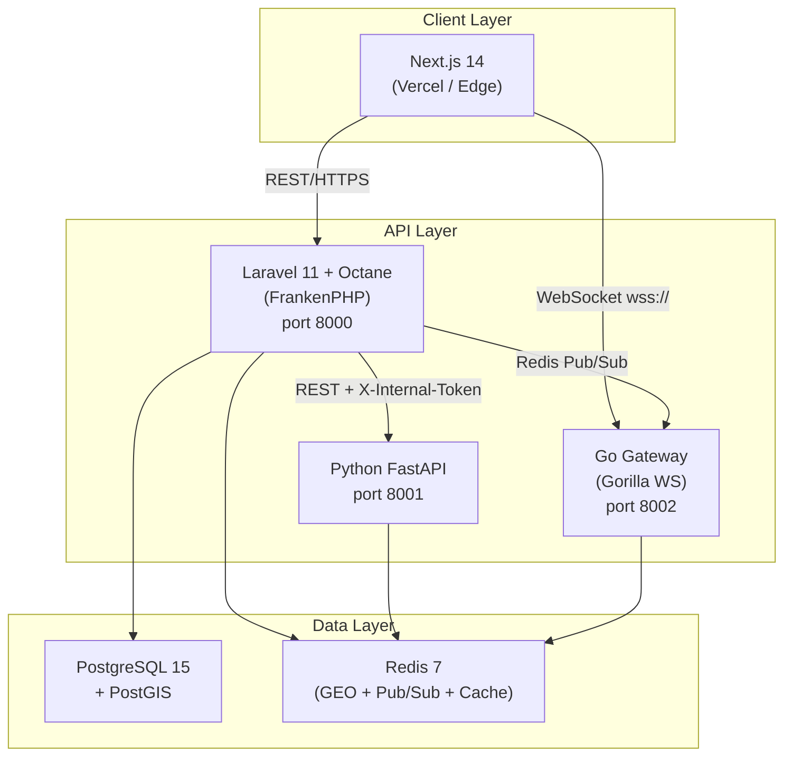

# Design Document — Polyglot Architecture Upgrade

## Overview

Soko Mtaa is being upgraded from a monolithic Laravel + Next.js + MySQL stack to a polyglot microservice architecture. The guiding principle is to route each problem to the runtime structurally built for it rather than stretching one language across all concerns.

**Four services, four distinct responsibilities:**

| Service | Runtime | Primary Role |
|---|---|---|
| Laravel_API | Laravel 11 + Octane (FrankenPHP) | Business logic, RBAC, M-Pesa, PostgreSQL |
| FastAPI_Service | Python FastAPI | NLP parsing, recipe scaling, pantry exclusion, trader matching |
| Go_Gateway | Go + Gorilla WebSockets | GPS ingestion, 100k+ WebSocket connections, Redis GEO writes |
| Next_JS_Client | Next.js 14 App Router | SSR, AI chat UI, live map with MapLibre GL |

The existing Laravel business logic (RBAC, M-Pesa flows, reservation lifecycle, SMS notifications, market fees) is **preserved and extended** — not replaced. The upgrade adds spatial querying capability, a dedicated AI engine, and a high-concurrency GPS layer.

---

## Architecture

### System Topology



### Communication Contracts

| Path | Protocol | Auth | Direction |
|---|---|---|---|
| Next.js → Laravel | REST/HTTPS | Sanctum token | All CRUD, auth, orders |
| Next.js → Go | WebSocket (wss://) | JWT query param | Rider position stream |
| Laravel → FastAPI | REST/HTTPS | X-Internal-Token header | AI pipeline calls |
| Laravel → Go | Redis Pub/Sub `rider_events` | shared Redis | Event notifications |
| All services → Redis | Redis client (native) | Redis AUTH | GEO, cache, pub/sub |

### Service Boundaries

**Laravel_API owns:**
- All user authentication and RBAC
- Reservation and order lifecycle
- M-Pesa STK Push and callbacks
- Market fee management
- Stall allocation and administration
- SMS notifications (Africa's Talking)
- The `POST /internal/ai/match-traders` internal endpoint
- Redis GEO sync for `active_traders`

**FastAPI_Service owns:**
- Natural language recipe parsing
- Ingredient quantity scaling
- Pantry exclusion conversation state (Redis sessions)
- Trader matching orchestration (calls Laravel internal endpoint)
- All `/ai/*` routes

**Go_Gateway owns:**
- WebSocket upgrade and lifecycle at `/ws/rider`
- GPS ping ingestion (GEOADD to `active_riders`)
- Rider disconnect detection and `rider.disconnected` pub/sub emission
- `/health` HTTP endpoint
- In-memory GPS buffer on Redis unavailability

**Next_JS_Client owns:**
- All server-rendered pages (App Router RSC)
- MapLibre GL canvas rendering
- Supercluster client-side clustering
- WebSocket hook for rider tracking
- Debounced bbox fetch (300ms)
- Offline detection and cached stall display

---

## Components and Interfaces

### Laravel_API Components

```
backend/app/
├── Http/Controllers/
│   ├── Map/
│   │   └── StallMapController.php          # GET /api/map/stalls (bbox query)
│   ├── Internal/
│   │   └── AiMatchController.php           # POST /internal/ai/match-traders
│   ├── Ai/
│   │   └── AiController.php                # POST /api/ai/chat (pipeline entry)
│   └── Delivery/
│       └── MultiCheckoutController.php     # POST /api/checkout/multi
├── Services/
│   ├── GeoService.php                      # PostGIS queries + Redis GEO sync
│   ├── AiPipelineService.php               # Circuit-breaker calls to FastAPI
│   └── MultiCheckoutService.php           # Atomic multi-merchant checkout
├── Http/Middleware/
│   └── InternalApiAuth.php                 # X-Internal-Token validation (exists)
└── Console/Commands/
    └── ReconcileGeoCache.php               # 5-min cron: active_traders reconcile
```

**New routes to add to `routes/api.php`:**

```php
// Public map endpoint (rate-limited)
Route::middleware(['auth:sanctum', 'throttle:60,1'])->group(function () {
    Route::get('/map/stalls', [StallMapController::class, 'withinViewport']);
});

// AI pipeline entry (rate-limited per resident)
Route::middleware(['auth:sanctum', 'role:resident', 'throttle:10,1'])->group(function () {
    Route::post('/ai/chat', [AiController::class, 'chat']);
});

// Health check (unauthenticated)
Route::get('/health', fn() => response()->json([
    'status' => 'ok',
    'db'     => 'ok',
    'redis'  => 'ok',
]));
```

```php
// Internal routes (InternalApiAuth middleware)
Route::middleware('internal.auth')->prefix('internal')->group(function () {
    Route::post('/ai/match-traders', [AiMatchController::class, 'match']);
});
```

### FastAPI_Service Components

```
fastapi_service/
├── app/
│   ├── main.py                     # FastAPI app, lifespan, middleware
│   ├── routers/
│   │   ├── recipe_parser.py        # POST /ai/parse-recipe
│   │   ├── pantry.py               # POST /ai/pantry-exclusion
│   │   ├── trader_match.py         # POST /ai/match-traders (calls Laravel)
│   │   └── health.py               # GET /ai/health
│   ├── models/
│   │   └── schemas.py              # Pydantic models (RecipeRequest, RecipeResponse, etc.)
│   ├── services/
│   │   ├── nlp_service.py          # spaCy/regex intent + headcount extraction
│   │   ├── recipe_scaler.py        # Per-person ratio table + scaling logic
│   │   ├── pantry_service.py       # Redis session state, deduction logic
│   │   └── laravel_client.py       # httpx client with circuit-breaker for Laravel
│   └── config.py                   # Settings (env vars, Redis URL, internal token)
├── requirements.txt
└── Dockerfile
```

**Key Pydantic schemas:**

```python
class CommodityItem(BaseModel):
    name: str
    quantity: float
    unit: str  # "kg", "bunch", "piece", "litre"

class RecipeRequest(BaseModel):
    text: str
    user_id: int

class RecipeResponse(BaseModel):
    commodities: list[CommodityItem]
    session_id: str

class PantryExclusionRequest(BaseModel):
    session_id: str
    pantry_items: list[str]  # Items user already has

class TraderMatchRequest(BaseModel):
    session_id: str
    resident_lat: float
    resident_lon: float
    radius_km: float = 5.0
```

### Go_Gateway Components

```
go_gateway/
├── main.go
├── handlers/
│   ├── rider_ws.go         # WebSocket upgrade, GPS ping loop
│   └── health.go           # GET /health
├── services/
│   ├── redis_service.go    # GEOADD, Pub/Sub publish
│   └── auth_service.go     # JWT token validation against Laravel
├── models/
│   └── gps_ping.go         # GpsPing struct {Lat, Lon float64}
├── config/
│   └── config.go           # Env vars (Redis URL, JWT secret, Laravel URL)
├── go.mod
└── Dockerfile
```

**WebSocket handler interface:**

```go
// POST /ws/rider?rider_id=<id>&token=<jwt>
func HandleRiderSocket(w http.ResponseWriter, r *http.Request) {
    // 1. Validate JWT token via auth_service
    // 2. Upgrade to WebSocket
    // 3. Set read deadline (30s idle timeout)
    // 4. Loop: ReadJSON → GpsPing → GeoAdd → Publish rider.position_updated
    // 5. On close: Publish rider.disconnected
}
```

### Next_JS_Client Components

New and modified files:

```
frontend/
├── app/
│   └── (resident)/
│       └── map/page.tsx                    # Live map page (new)
├── components/
│   └── map/
│       ├── StallMap.tsx                    # MapLibre GL canvas (replaces Leaflet)
│       ├── RiderMarker.tsx                 # Boda rider icon layer
│       ├── StallBottomSheet.tsx            # Stall tap overlay
│       └── ClusterLayer.tsx               # Supercluster integration
├── hooks/
│   ├── useStallMap.ts                      # Debounced bbox fetch hook
│   ├── useRiderTracking.ts                 # WebSocket hook with exponential backoff
│   └── useMapClusters.ts                   # Supercluster zoom logic
└── lib/
    └── mapUtils.ts                         # GeoJSON conversion, bbox helpers
```

**Key hook interfaces:**

```typescript
// useStallMap — debounced 300ms bbox fetch
function useStallMap(map: MapLibreMap | null): {
  stalls: StallFeature[];
  isLoading: boolean;
  isOffline: boolean;
}

// useRiderTracking — WebSocket with backoff
function useRiderTracking(riderId: string | null): {
  position: [number, number] | null;
  isConnected: boolean;
  isTrackingUnavailable: boolean;
}
```

---

## Data Models

### PostgreSQL Schema Changes

**Migration: `add_postgis_location_to_stalls`**

```php
public function up(): void
{
    // Require PostGIS — halt if not available
    $check = DB::select("SELECT 1 FROM pg_extension WHERE extname = 'postgis'");
    if (empty($check)) {
        throw new \RuntimeException(
            'PostGIS extension is not installed on this PostgreSQL instance. ' .
            'Run: CREATE EXTENSION postgis; as a superuser before this migration.'
        );
    }

    DB::statement('ALTER TABLE stalls ADD COLUMN location GEOGRAPHY(Point, 4326)');
    DB::statement(
        'CREATE INDEX stalls_location_gist_idx ON stalls USING GIST (location)'
    );
}

public function down(): void
{
    DB::statement('DROP INDEX IF EXISTS stalls_location_gist_idx');
    DB::statement('ALTER TABLE stalls DROP COLUMN IF EXISTS location');
}
```

**Migration: `populate_stall_locations_from_pixel_coords`**

Converts `map_x` / `map_y` pixel offsets (Kolenyo Market CRS.Simple canvas) to WGS-84 coordinates:

```php
// Kolenyo Market reference: lat -0.0917, lon 34.7679
// Canvas pixel range: x 0–460, y 0–370
// Mapping: pixel → approximate degree offset
// Scale: ~0.00005 degrees per pixel (tunable per market)

public function up(): void
{
    $marketLat = -0.0917;
    $marketLon = 34.7679;
    $pixelScaleLat = 0.00005;
    $pixelScalelon = 0.00005;

    $migrated = 0;
    $skipped  = 0;

    DB::table('stalls')
        ->whereNotNull('map_x')
        ->whereNotNull('map_y')
        ->whereNull('location')          // idempotent: skip already-set rows
        ->orderBy('id')
        ->chunk(200, function ($stalls) use (
            $marketLat, $marketLon, $pixelScaleLat, $pixelScalelon,
            &$migrated
        ) {
            foreach ($stalls as $stall) {
                $lon = $marketLon + ($stall->map_x * $pixelScalelon);
                $lat = $marketLat - ($stall->map_y * $pixelScaleLat);

                DB::table('stalls')->where('id', $stall->id)->update([
                    'location' => DB::raw(
                        "ST_SetSRID(ST_MakePoint({$lon}, {$lat}), 4326)::geography"
                    ),
                ]);
                $migrated++;
            }
        });

    DB::table('stalls')
        ->whereNull('map_x')
        ->orWhereNull('map_y')
        ->get()
        ->each(fn($s) => Log::info("Stall {$s->id} skipped: null coordinates"));

    Log::info("Stall location migration complete: {$migrated} migrated.");
}
```

**Modified Stall Eloquent model:**

```php
// app/Models/Stall.php additions
protected $casts = [
    'location' => 'string', // raw WKB — use accessor for lon/lat
];

public function getLatAttribute(): ?float
{
    if (!$this->location) return null;
    $result = DB::select(
        'SELECT ST_Y(location::geometry) as lat FROM stalls WHERE id = ?',
        [$this->id]
    );
    return $result[0]->lat ?? null;
}

public function getLonAttribute(): ?float
{
    if (!$this->location) return null;
    $result = DB::select(
        'SELECT ST_X(location::geometry) as lon FROM stalls WHERE id = ?',
        [$this->id]
    );
    return $result[0]->lon ?? null;
}
```

### Redis Key Structures

| Key | Type | Purpose | TTL |
|---|---|---|---|
| `active_traders` | GEO set | Open stall positions — `GEOADD active_traders lon lat stall_id` | None (managed by open/close events) |
| `active_riders` | GEO set | Live rider positions — `GEOADD active_riders lon lat rider_id` | None (managed by disconnect events) |
| `ai:session:{session_id}` | Hash | FastAPI pantry exclusion state (`commodities`, `user_id`, `step`) | 30 min TTL |
| `stall:geo:cache:{bbox_hash}` | String (JSON) | Cached bbox query result | 5s TTL |
| `rider_events` | Pub/Sub channel | `rider.position_updated` and `rider.disconnected` events | N/A |

**Redis Pub/Sub event payloads:**

```json
// rider.position_updated
{
  "event": "rider.position_updated",
  "rider_id": "42",
  "lat": -0.0914,
  "lon": 34.7682,
  "timestamp": 1720000000
}

// rider.disconnected
{
  "event": "rider.disconnected",
  "rider_id": "42",
  "timestamp": 1720000100
}
```

### FastAPI Session State (Redis Hash)

```
ai:session:{uuid}
  ├── user_id         → "101"
  ├── step            → "pantry_exclusion" | "trader_matching" | "fulfilment"
  ├── commodities     → JSON array of CommodityItem
  ├── original_commodities → JSON array (for round-trip validation)
  └── created_at      → epoch timestamp
```

### Multi-Merchant Checkout Payload

Laravel assembles this before triggering STK Push:

```json
{
  "resident_id": 101,
  "delivery_type": "rider",
  "delivery_fee": 150,
  "total_amount": 850,
  "items": [
    {
      "trader_id": 5,
      "product_id": 12,
      "product_name": "Sukuma Wiki",
      "quantity": 3,
      "unit_price": 20,
      "subtotal": 60
    },
    {
      "trader_id": 9,
      "product_id": 31,
      "product_name": "Maize Flour (ugali)",
      "quantity": 2,
      "unit_price": 170,
      "subtotal": 340
    }
  ]
}
```

---

## Correctness Properties

*A property is a characteristic or behavior that should hold true across all valid executions of a system — essentially, a formal statement about what the system should do. Properties serve as the bridge between human-readable specifications and machine-verifiable correctness guarantees.*


### Property 1: Stall Location Write Round-Trip

*For any* stall record and any valid WGS-84 longitude/latitude pair, creating or updating the stall with those coordinates and then reading back `ST_X(location::geometry)` and `ST_Y(location::geometry)` should return values within floating-point epsilon of the original coordinates.

**Validates: Requirements 1.5**

---

### Property 2: Migration Completeness

*For all* stall records that have non-null `map_x` and non-null `map_y` values, after the coordinate-population migration runs, the `location` column should be non-null.

**Validates: Requirements 1.6, 15.1**

---

### Property 3: Viewport Bbox Containment

*For any* valid viewport bounding box (min_lon, min_lat, max_lon, max_lat) and any stall dataset, every stall returned by `GET /api/map/stalls` should have a `location` that is geometrically within the bounding box as determined by `ST_Within(location::geometry, ST_MakeEnvelope(..., 4326))`.

**Validates: Requirements 2.2**

---

### Property 4: Maintenance Stall Exclusion

*For any* valid viewport bounding box query, no stall with `status = 'maintenance'` should appear in the response. The filter should hold regardless of the bbox boundaries or the distribution of stall statuses in the database.

**Validates: Requirements 2.4**

---

### Property 5: Active Trader GEO Membership

*For any* stall that is marked `is_open = true`, after the open event is processed, the stall's ID should be a member of the `active_traders` Redis GEO set.

**Validates: Requirements 3.1**

---

### Property 6: Stall Open/Close Redis Round-Trip

*For any* stall, opening it (GEOADD to `active_traders`) and then immediately closing it (ZREM from `active_traders`) should result in the stall's ID being absent from the `active_traders` GEO set, returning to the pre-open state.

**Validates: Requirements 3.2**

---

### Property 7: GPS Ping Position Round-Trip

*For any* rider ID and any valid GPS ping `{lat, lon}`, after the Go_Gateway processes the ping, executing `GEOPOS active_riders <rider_id>` should return coordinates that match the pinged position within GPS precision tolerance (±0.0001 degrees).

**Validates: Requirements 3.3, 4.2**

---

### Property 8: Single GEO Entry Per Rider

*For any* rider, after N GPS pings (N ≥ 1), the number of entries in `active_riders` for that rider's ID should be exactly 1, regardless of how many pings were sent. GEOADD overwrites rather than appends.

**Validates: Requirements 3.4**

---

### Property 9: Rider Disconnect Cleans GEO State

*For any* rider whose WebSocket connection closes, after the `rider.disconnected` Pub/Sub event is processed by the Laravel_API, the rider's ID should not be present in the `active_riders` Redis GEO set.

**Validates: Requirements 3.5, 3.6**

---

### Property 10: active_traders Consistency with Database

*For all* stalls in the database, the membership of each stall's ID in the `active_traders` Redis GEO set should match the stall's `is_open` field: stalls with `is_open = true` should be present, stalls with `is_open = false` should be absent.

**Validates: Requirements 3.7**

---

### Property 11: Position Updated Event Emitted on Each Write

*For any* successful `GEOADD active_riders` operation, a `rider.position_updated` event should be published to the `rider_events` Redis Pub/Sub channel containing the correct rider ID, latitude, and longitude.

**Validates: Requirements 4.8**

---

### Property 12: Recipe Parse Produces Valid Commodity Structure

*For any* valid recipe request text that contains a recognisable meal name and headcount, the FastAPI response should include a `commodities` array where every element has a non-empty `name` (string), a positive `quantity` (number), and a non-empty `unit` (string).

**Validates: Requirements 5.2, 5.4**

---

### Property 13: Headcount Scaling is Linear (Metamorphic)

*For any* valid recipe text, if the headcount is doubled while keeping the meal description constant, every `quantity` in the resulting `commodities` array should also double (within floating-point tolerance), preserving the proportional scaling invariant.

**Validates: Requirements 5.3**

---

### Property 14: Recipe Parse Idempotence

*For any* valid recipe request text, parsing the same text twice (same `text`, same meal context) should produce a `commodities` array that is equivalent in content — same items, same quantities, same units — regardless of how many times the endpoint is called.

**Validates: Requirements 5.8**

---

### Property 15: RecipeResponse Serialisation Round-Trip

*For any* valid `RecipeResponse` object, serialising it to JSON and then deserialising that JSON back into a `RecipeResponse` object should produce a value that, when re-serialised, yields a byte-for-byte identical JSON string. This subsumes the length invariant: the number of commodity items must be preserved under round-trip.

**Validates: Requirements 6.3, 6.4**

---

### Property 16: Pantry Deduction Removes Specified Items

*For any* `Commodity_List` and any non-empty set of pantry items that are a subset of the commodity names, after a pantry exclusion operation, none of the confirmed pantry items should appear in the returned `commodities` array (either removed entirely or with fully-deducted quantity).

*Edge cases covered:* (a) when all items are in pantry — result is empty array (Requirement 7.3); (b) when no items are in pantry — original list is unchanged (Requirement 7.6).

**Validates: Requirements 7.2, 7.3, 7.6**

---

### Property 17: No Zero-Quantity Items After Pantry Exclusion

*For any* pantry exclusion operation on any `Commodity_List`, every `CommodityItem` in the returned list should have a `quantity` strictly greater than zero. Items that would reach zero quantity should be fully removed rather than appearing with `quantity: 0`.

**Validates: Requirements 7.7**

---

### Property 18: Trader Ranking by Price Ascending

*For any* commodity item matched against any set of traders, the traders returned by `POST /internal/ai/match-traders` for that commodity should be ordered by `price` ascending — the cheapest option first — with no lower-priced trader appearing after a higher-priced one.

**Validates: Requirements 8.3**

---

### Property 19: Internal Endpoints Reject Unauthenticated Requests

*For any* request to an internal service endpoint (`POST /internal/ai/match-traders` on Laravel, any route on FastAPI_Service) that is missing a valid `X-Internal-Token` header or carries an incorrect token value, the service should respond with HTTP 401 and refuse to process the request.

**Validates: Requirements 8.6, 14.2, 14.3**

---

### Property 20: Delivery Fee Proportional to Max Trader Distance

*For any* set of trader stall positions and a resident position, the calculated delivery fee should be monotonically non-decreasing as the distance to the furthest trader increases — a strictly farther maximum trader location should never produce a lower delivery fee than a closer one.

**Validates: Requirements 9.2**

---

### Property 21: Multi-Merchant Checkout Payload Contains All Items

*For any* selection of N commodity-trader pairs in the AI pipeline, the assembled multi-merchant checkout payload should contain exactly N line items, each with the correct `trader_id`, `product_id`, `quantity`, `unit_price`, and computed `subtotal`. No selected item may be silently dropped.

**Validates: Requirements 9.3**

---

### Property 22: Successful Payment Creates All Reservations as Paid

*For any* multi-merchant checkout with N traders, when the STK Push payment succeeds, exactly N reservation records should be created in the database, all with `status = 'paid'`. The count of new reservations must equal the count of distinct traders in the order.

**Validates: Requirements 9.5, 9.7**

---

### Property 23: Failed Payment Creates No Reservations

*For any* multi-merchant checkout where the STK Push payment fails, zero reservation records should be created in the database for that order. The database state should be identical before and after the failed payment attempt.

**Validates: Requirements 9.6, 9.7**

---

### Property 24: Supercluster Applied at Zoom Below 15

*For any* set of stall GeoJSON features and any map zoom level strictly less than 15, the clustering layer should group nearby features into cluster objects rather than rendering individual stall markers. At zoom levels ≥ 15, individual markers should be rendered without clustering.

**Validates: Requirements 10.3**

---

### Property 25: Exponential Backoff Stays Within Bounds

*For any* sequence of reconnect attempts in `useRiderTracking`, the delay before the Nth attempt should satisfy `delay(N) = min(2^(N-1) * 1000ms, 30000ms)`. The delay should never fall below the previous attempt's delay, should never exceed 30 seconds, and should start at 1 second for the first attempt.

**Validates: Requirements 11.3**

---

### Property 26: Circuit-Breaker Timeout on FastAPI Unavailability

*For any* call from the Laravel_API to the FastAPI_Service where the FastAPI service hangs or is unreachable, the Laravel_API should return a `SERVICE_UNAVAILABLE` response to the client within 5 seconds of the call being initiated — never blocking the client indefinitely.

**Validates: Requirements 12.7**

---

### Property 27: Go_Gateway Rejects WebSocket Without Valid JWT

*For any* WebSocket upgrade request to `/ws/rider` that is missing a token, carries an expired token, or carries a token with an invalid signature, the Go_Gateway should refuse the upgrade with an appropriate HTTP 4xx status and should not establish a WebSocket connection.

**Validates: Requirements 14.1**

---

### Property 28: Migration Idempotence

*For any* database state containing stall records with `location` values already set, running the coordinate-population migration a second time should leave those `location` values unchanged. The migration should skip rows where `location` is already populated, producing the same database state as if the migration had been run only once.

**Validates: Requirements 15.5**

---

## Error Handling

### Laravel_API Error Handling

All error responses follow the existing `ApiResponse` trait format (`success`, `message`, `errors`, `code`). New error codes added for the polyglot upgrade:

| Code | HTTP | When |
|---|---|---|
| `SERVICE_UNAVAILABLE` | 503 | FastAPI not reachable within 5s circuit-breaker timeout |
| `POSTGIS_UNAVAILABLE` | 500 | PostGIS extension missing at migration time |
| `GEO_SYNC_FAILED` | 500 | Redis GEO write failed after retry |
| `MULTI_CHECKOUT_PARTIAL` | 500 | Atomicity violation — should never reach client, triggers rollback |

**Circuit-breaker for FastAPI calls (`AiPipelineService.php`):**

```php
public function callFastApi(string $endpoint, array $payload): array
{
    try {
        $response = Http::timeout(5)
            ->withHeaders(['X-Internal-Token' => config('services.fastapi.token')])
            ->post(config('services.fastapi.url') . $endpoint, $payload);

        if ($response->failed()) {
            Log::channel('fastapi')->error('FastAPI error', [
                'endpoint' => $endpoint,
                'status'   => $response->status(),
                'body'     => $response->body(),
                // Note: payload logged without PII 'text' fields
            ]);
            return $this->error('AI service returned an error', 'SERVICE_UNAVAILABLE', 503);
        }

        return $response->json();
    } catch (\Illuminate\Http\Client\ConnectionException $e) {
        Log::channel('fastapi')->error('FastAPI unreachable', ['error' => $e->getMessage()]);
        return $this->error('AI service is temporarily unavailable', 'SERVICE_UNAVAILABLE', 503);
    }
}
```

**Multi-merchant checkout atomicity (`MultiCheckoutService.php`):**

```php
public function checkout(array $payload, User $resident): array
{
    return DB::transaction(function () use ($payload, $resident) {
        // 1. Trigger STK Push
        $payment = $this->mpesaService->stkPush(
            $resident->phone,
            $payload['total_amount'],
            'MULTI-' . Str::uuid(),
            'Soko Mtaa multi-trader order'
        );

        if ($payment['ResponseCode'] !== '0') {
            // Transaction rolls back — no reservations created
            throw new PaymentFailedException($payment['ResponseDescription']);
        }

        // 2. Create all reservations only on payment success
        foreach ($payload['items'] as $item) {
            Reservation::create([
                'reservation_code' => 'SM-' . strtoupper(Str::random(8)),
                'resident_id'      => $resident->id,
                'trader_id'        => $item['trader_id'],
                'product_id'       => $item['product_id'],
                'quantity'         => $item['quantity'],
                'unit_price'       => $item['unit_price'],
                'total_amount'     => $item['subtotal'],
                'status'           => 'paid',
                'pickup_deadline'  => now()->addHours(24),
            ]);
        }

        return ['status' => 'paid', 'reservation_count' => count($payload['items'])];
    });
}
```

### FastAPI_Service Error Handling

```python
from fastapi import HTTPException
from fastapi.responses import JSONResponse

# Session not found
if not session_data:
    raise HTTPException(
        status_code=404,
        detail={"code": "SESSION_NOT_FOUND", "message": "Session expired or not found. Please restart from Step 1."}
    )

# Parse failed
if not commodities:
    raise HTTPException(
        status_code=422,
        detail={"code": "PARSE_FAILED", "message": "Could not extract meal name or headcount from your text."}
    )

# NLP model not loaded (set at startup)
if not nlp_model_ready:
    raise HTTPException(
        status_code=503,
        detail={"code": "SERVICE_UNAVAILABLE", "message": "AI model is loading. Please try again shortly."}
    )
```

### Go_Gateway Error Handling

```go
// Invalid GPS coordinates — close with Policy Violation
if ping.Lat < -90 || ping.Lat > 90 || ping.Lon < -180 || ping.Lon > 180 {
    log.Printf("rider %s sent invalid coords: lat=%f lon=%f", riderID, ping.Lat, ping.Lon)
    conn.WriteMessage(websocket.CloseMessage,
        websocket.FormatCloseMessage(1008, "Invalid GPS coordinates"))
    return
}

// Redis unavailable — buffer in memory
if err := redisService.GeoAdd(ctx, riderID, ping); err != nil {
    log.Printf("Redis write failed for rider %s: %v — buffering", riderID, err)
    buffer.Add(riderID, ping, time.Now().Add(30*time.Second))
}
```

### Next.js Client Error Handling

The `useRiderTracking` hook uses exponential backoff and reports degradation after 3 failed attempts. The `useStallMap` hook caches the last successful response in `localStorage` keyed by bbox hash and serves cached data with an offline indicator when the network is unavailable.

---

## Testing Strategy

### Dual Testing Approach

Both unit/example tests and property-based tests are required. They serve complementary roles: example tests verify specific known behaviors (endpoint contracts, error codes, edge cases), while property tests verify universal invariants across all generated inputs.

### Unit Tests

**Laravel (PHPUnit):**
- `GeoServiceTest` — stall open/close Redis GEO sync, bbox query results exclude maintenance stalls
- `AiPipelineServiceTest` — circuit-breaker fires after 5s, error response format
- `MultiCheckoutServiceTest` — atomic transaction rolls back fully on payment failure
- `StallMapControllerTest` — 422 on invalid bbox parameters, correct SQL query shape
- `InternalApiAuthTest` — 401 on missing/invalid X-Internal-Token
- `CoordinateMigrationTest` — null map_x/map_y rows are skipped, idempotency (run twice = same state)

**Python (pytest):**
- `test_recipe_parser.py` — each Kenyan staple parses successfully, PARSE_FAILED on garbage input
- `test_pantry_exclusion.py` — SESSION_NOT_FOUND on unknown session_id, empty list when all items excluded
- `test_health.py` — 503 when NLP model flag is unset, 200 when ready
- `test_roundtrip.py` — `POST /ai/parse-recipe/roundtrip` endpoint returns identical JSON

**Go (testing package):**
- `health_handler_test.go` — returns 200 with `{status: ok}` when Redis reachable
- `auth_service_test.go` — rejects missing/expired/invalid JWT
- `redis_service_test.go` — buffer drains correctly after Redis recovers
- `rider_ws_test.go` — close code 1008 on out-of-range coordinates

**Next.js (Vitest + React Testing Library):**
- `useRiderTracking.test.ts` — backoff sequence, tracking unavailable banner after 3 failures
- `useStallMap.test.ts` — debounce fires once after 300ms, not on each intermediate event
- `StallMap.test.tsx` — renders offline banner when navigator.onLine = false

### Property-Based Tests

Property-based testing uses:
- **Laravel/PHP:** [eris](https://github.com/giorgiosironi/eris) or [PHPCheck](https://github.com/code418/phpcheck)
- **Python:** [hypothesis](https://hypothesis.readthedocs.io/) — minimum 100 iterations per property
- **Go:** [rapid](https://github.com/flyingmutant/rapid) — minimum 100 iterations per property
- **TypeScript/Next.js:** [fast-check](https://fast-check.dev/) — minimum 100 iterations per property

Each property test is tagged with a comment in the format:
`Feature: polyglot-architecture-upgrade, Property {N}: {property_text}`

**Property test assignments by service:**

| Property | Service | Library |
|---|---|---|
| P1: Stall location write round-trip | Laravel | eris |
| P2: Migration completeness | Laravel | eris |
| P3: Bbox containment | Laravel | eris |
| P4: Maintenance stall exclusion | Laravel | eris |
| P5: Open stall in active_traders | Laravel | eris |
| P6: Open/close round-trip | Laravel | eris |
| P7: GPS ping position round-trip | Go | rapid |
| P8: Single GEO entry per rider | Go | rapid |
| P9: Rider disconnect removes from GEO | Go | rapid |
| P10: active_traders consistent with DB | Laravel | eris |
| P11: Position updated event emitted | Go | rapid |
| P12: Recipe parse structure valid | Python | hypothesis |
| P13: Headcount scaling linear | Python | hypothesis |
| P14: Recipe parse idempotent | Python | hypothesis |
| P15: RecipeResponse serialisation round-trip | Python | hypothesis |
| P16: Pantry deduction removes items | Python | hypothesis |
| P17: No zero-quantity items post-exclusion | Python | hypothesis |
| P18: Trader ranking price ascending | Laravel | eris |
| P19: Internal endpoints reject unauthenticated | Laravel + Python + Go | eris / hypothesis / rapid |
| P20: Delivery fee proportional to distance | Laravel | eris |
| P21: Checkout payload contains all items | Laravel | eris |
| P22: Successful payment → all reservations paid | Laravel | eris |
| P23: Failed payment → no reservations | Laravel | eris |
| P24: Supercluster at zoom < 15 | Next.js | fast-check |
| P25: Exponential backoff bounds | Next.js | fast-check |
| P26: Circuit-breaker timeout | Laravel | eris |
| P27: Go_Gateway rejects invalid JWT | Go | rapid |
| P28: Migration idempotence | Laravel | eris |

**Example property test (Python / hypothesis):**

```python
# Feature: polyglot-architecture-upgrade, Property 13: Headcount scaling is linear
from hypothesis import given, settings
import hypothesis.strategies as st
from app.services.recipe_scaler import scale_recipe

@given(
    headcount_a=st.integers(min_value=1, max_value=50),
    meal=st.sampled_from(["ugali", "sukuma wiki", "eggs", "rice", "beans", "chapati"])
)
@settings(max_examples=100)
def test_headcount_scaling_is_linear(headcount_a, meal):
    headcount_b = headcount_a * 2
    result_a = scale_recipe(meal, headcount_a)
    result_b = scale_recipe(meal, headcount_b)

    for item_a, item_b in zip(result_a, result_b):
        assert item_a.name == item_b.name
        assert abs(item_b.quantity - item_a.quantity * 2) < 0.001, \
            f"Doubling headcount did not double quantity for {item_a.name}"
```

**Example property test (Go / rapid):**

```go
// Feature: polyglot-architecture-upgrade, Property 7: GPS ping position round-trip
func TestGpsPingPositionRoundTrip(t *testing.T) {
    rapid.Check(t, func(t *rapid.T) {
        riderID := rapid.StringN(1, 20, -1).Draw(t, "riderID").(string)
        lat := rapid.Float64Range(-90, 90).Draw(t, "lat").(float64)
        lon := rapid.Float64Range(-180, 180).Draw(t, "lon").(float64)

        err := redisService.GeoAdd(ctx, "active_riders", riderID, lon, lat)
        require.NoError(t, err)

        positions, err := redisClient.GeoPos(ctx, "active_riders", riderID).Result()
        require.NoError(t, err)
        require.Len(t, positions, 1)

        assert.InDelta(t, lon, positions[0].Longitude, 0.0001)
        assert.InDelta(t, lat, positions[0].Latitude, 0.0001)
    })
}
```

**Example property test (Laravel / eris):**

```php
// Feature: polyglot-architecture-upgrade, Property 3: Viewport Bbox Containment
public function testBboxQueryReturnsOnlyContainedStalls(): void
{
    $this->forAll(
        Generator\float(-179, 179), // min_lon
        Generator\float(-89, 89),   // min_lat
        Generator\float(-179, 179), // delta_lon (added to make max_lon)
        Generator\float(-89, 89),   // delta_lat (added to make max_lat)
    )->then(function ($minLon, $minLat, $deltaLon, $deltaLat) {
        $maxLon = min($minLon + abs($deltaLon) + 0.01, 180);
        $maxLat = min($minLat + abs($deltaLat) + 0.01, 90);

        $response = $this->getJson("/api/map/stalls?min_lon={$minLon}&min_lat={$minLat}&max_lon={$maxLon}&max_lat={$maxLat}");
        $stalls = $response->json('data');

        foreach ($stalls as $stall) {
            $this->assertGreaterThanOrEqual($minLon, $stall['lon']);
            $this->assertLessThanOrEqual($maxLon, $stall['lon']);
            $this->assertGreaterThanOrEqual($minLat, $stall['lat']);
            $this->assertLessThanOrEqual($maxLat, $stall['lat']);
        }
    });
}
```

---

## Deployment Topology

### Service Deployment Targets

| Service | Environment | Platform | Port |
|---|---|---|---|
| Laravel_API | VPS (Ubuntu 22.04) | FrankenPHP / Docker | 8000 |
| FastAPI_Service | VPS | Docker | 8001 |
| Go_Gateway | VPS | Docker | 8002 |
| Next_JS_Client | Vercel | Edge runtime | 443 |
| PostgreSQL + PostGIS | VPS | Docker (postgres:15-alpine + postgis) | 5432 |
| Redis | VPS | Docker (redis:7-alpine) | 6379 |

### Docker Compose (VPS)

```yaml
version: "3.9"
services:
  postgres:
    image: postgis/postgis:15-3.3-alpine
    environment:
      POSTGRES_DB: sokomtaa
      POSTGRES_USER: sokomtaa
      POSTGRES_PASSWORD: ${POSTGRES_PASSWORD}
    volumes:
      - pgdata:/var/lib/postgresql/data
    ports:
      - "5432:5432"

  redis:
    image: redis:7-alpine
    command: redis-server --requirepass ${REDIS_PASSWORD}
    volumes:
      - redisdata:/data
    ports:
      - "6379:6379"

  laravel:
    image: sokomtaa/laravel:latest
    depends_on: [postgres, redis]
    environment:
      DB_CONNECTION: pgsql
      DB_HOST: postgres
      DB_PORT: 5432
      REDIS_HOST: redis
      INTERNAL_API_TOKEN: ${INTERNAL_API_TOKEN}
    ports:
      - "8000:8000"

  fastapi:
    image: sokomtaa/fastapi:latest
    depends_on: [redis]
    environment:
      REDIS_URL: redis://:${REDIS_PASSWORD}@redis:6379
      INTERNAL_TOKEN: ${INTERNAL_API_TOKEN}
      LARAVEL_INTERNAL_URL: http://laravel:8000
    ports:
      - "8001:8001"

  go_gateway:
    image: sokomtaa/go-gateway:latest
    depends_on: [redis]
    environment:
      REDIS_URL: redis://:${REDIS_PASSWORD}@redis:6379
      JWT_SECRET: ${JWT_SECRET}
      LARAVEL_URL: http://laravel:8000
    ports:
      - "8002:8002"

volumes:
  pgdata:
  redisdata:
```

### Nginx Reverse Proxy Routing

```nginx
# /ws/rider → Go Gateway (WebSocket upgrade)
location /ws/ {
    proxy_pass http://localhost:8002;
    proxy_http_version 1.1;
    proxy_set_header Upgrade $http_upgrade;
    proxy_set_header Connection "upgrade";
}

# /ai/* → FastAPI (internal — not exposed publicly)
# FastAPI is only accessible from Laravel over Docker internal network

# /api/* → Laravel
location /api/ {
    proxy_pass http://localhost:8000;
}

# /health → Go Gateway health (for load balancer probes)
location /go/health {
    proxy_pass http://localhost:8002/health;
}
```

### Environment Variables Summary

**Laravel `.env` additions:**

```env
DB_CONNECTION=pgsql
DB_HOST=127.0.0.1
DB_PORT=5432
DB_DATABASE=sokomtaa
DB_USERNAME=sokomtaa
DB_PASSWORD=

REDIS_HOST=127.0.0.1
REDIS_PASSWORD=
REDIS_PORT=6379

FASTAPI_URL=http://fastapi:8001
FASTAPI_INTERNAL_TOKEN=

INTERNAL_API_TOKEN=
```

**FastAPI `.env`:**

```env
REDIS_URL=redis://:password@redis:6379
INTERNAL_TOKEN=
LARAVEL_INTERNAL_URL=http://laravel:8000
NLP_MODEL=en_core_web_sm
PRODUCTION=true
```

**Go Gateway `.env`:**

```env
REDIS_URL=redis://:password@redis:6379
JWT_SECRET=
LARAVEL_URL=http://laravel:8000
PORT=8002
```

### Deployment Sequence

1. Provision PostgreSQL with PostGIS extension (`CREATE EXTENSION postgis;`)
2. Run `php artisan migrate` — schema migrations including `location` column and GiST index
3. Run coordinate population migration — converts `map_x`/`map_y` to WGS-84 geography
4. Seed `active_traders` Redis GEO from all currently open stalls (post-migration step)
5. Deploy FastAPI service — verify `/ai/health` returns 200 before enabling AI routes
6. Deploy Go Gateway — verify `/health` returns 200 and Redis is reachable
7. Deploy Laravel (Octane/FrankenPHP) — verify `/api/health` returns all-green
8. Deploy Next.js to Vercel — set `NEXT_PUBLIC_API_URL` and `NEXT_PUBLIC_WS_URL`
9. Run reconciliation cron (`ReconcileGeoCache`) to verify `active_traders` consistency

### Reconciliation Cron

```php
// app/Console/Commands/ReconcileGeoCache.php
// Runs every 5 minutes via Laravel scheduler

public function handle(): void
{
    $openStalls = Stall::whereHas('trader', fn($q) => $q->where('is_open', true))
                       ->whereNotNull('location')
                       ->get();

    foreach ($openStalls as $stall) {
        Redis::geoadd('active_traders', $stall->lon, $stall->lat, $stall->id);
    }

    // Remove stalls from GEO that are no longer open
    $geoMembers = Redis::zrange('active_traders', 0, -1);
    $openIds    = $openStalls->pluck('id')->map(fn($id) => (string) $id)->toArray();
    $stale      = array_diff($geoMembers, $openIds);

    if (!empty($stale)) {
        Redis::zrem('active_traders', ...$stale);
        Log::info('Reconcile: removed ' . count($stale) . ' stale entries from active_traders');
    }
}
```
