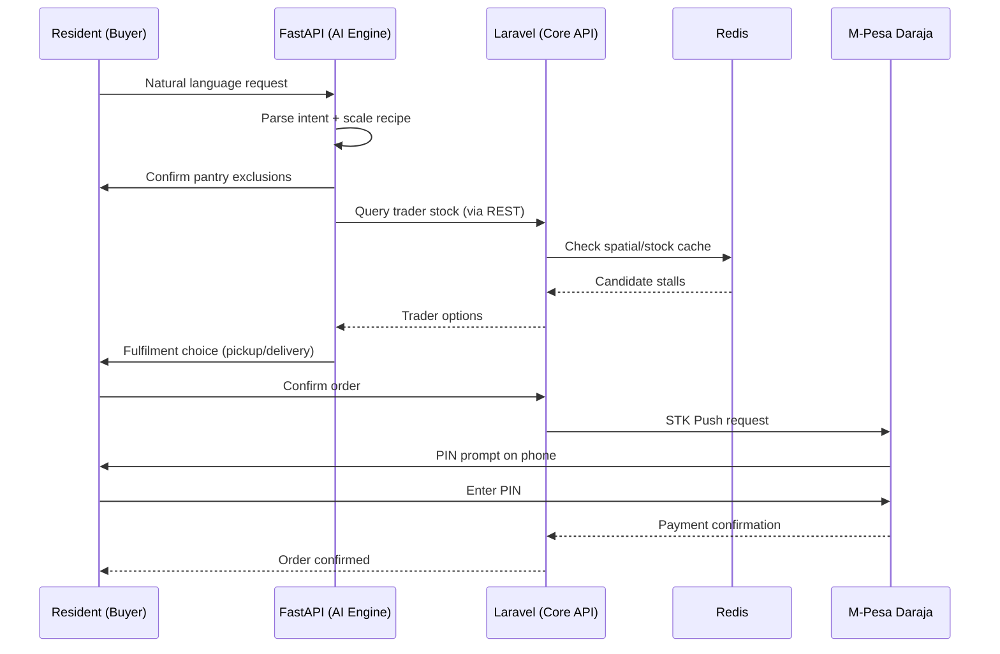
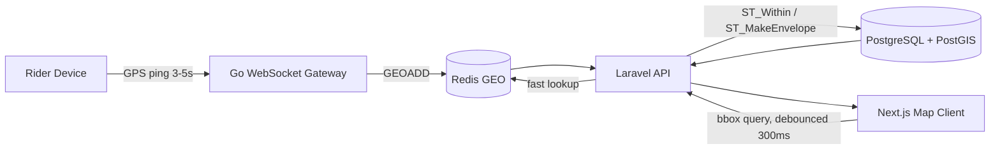

# Soko Mtaa — Polyglot Architecture Upgrade Specification
**Hyper-Local Kenyan Commerce Platform**
**Scope:** Backend architecture upgrade, real-time spatial map service, conversational AI checkout pipeline

---

## 1. Overview & Objective

Soko Mtaa connects four actor groups — **Residents (Buyers)**, **Local Traders/Stalls**, **Boda Boda Riders**, and **County Administrators** — in a single digital marketplace. This specification upgrades the platform from a single-stack system to a **polyglot microservice architecture**, assigning each language/runtime to the workload it is objectively best at, connected via gRPC, REST, and Redis Pub/Sub.

The guiding principle: **use one stack for what it's good at, not one stack for everything.** Below, each service is paired with *why* that language wins for that specific job — not just what it does.

---

## 2. Responsibility Matrix — What Runs Where, and Why

| Layer | Stack | Core Responsibility | Why This Language Wins Here |
|---|---|---|---|
| **Frontend** | Next.js (App Router, RSC, MapLibre GL / Canvas) | SSR page delivery, reactive AI chat UI, debounced map controls, WebSocket listeners | React Server Components cut client JS for SSR-heavy commerce pages; Next.js owns the browser-rendering problem (hydration, streaming, edge caching) better than any backend language could from the server side |
| **Core API & Business Engine** | Laravel 11 + Octane (FrankenPHP) | RBAC auth, order lifecycles, relational data (PostgreSQL), M-Pesa Daraja STK Push | Laravel's ORM/migrations/queue ecosystem is unmatched for fast, safe CRUD and transactional business rules; Octane + FrankenPHP removes PHP's traditional per-request bootstrap cost, giving 2–5ms responses — PHP's classic weakness engineered away |
| **AI & NLP Engine** | Python (FastAPI, async) | Conversational NLP parsing, recipe/ingredient scaling, pantry-exclusion logic, semantic search (pgvector / Qdrant) | Python owns the ML/NLP ecosystem (tokenizers, embeddings, vector libraries); no other language in this stack has comparable library depth for this category of work, and FastAPI's async model keeps it from being a latency bottleneck |
| **Real-Time GPS & Spatial Engine** | Go (Gorilla WebSockets) | High-frequency rider GPS ingestion (3–5s ping), 100,000+ concurrent WebSocket connections, Redis GEO writes | Go's goroutines make massive concurrent socket handling cheap in memory and CPU in a way PHP/Python cannot match at this connection count; this is the one layer where raw concurrency, not developer ergonomics, is the deciding factor |

**Supercharge logic, in one line:** PHP/Laravel for *correctness and speed of business logic*, Python for *intelligence*, Go for *raw concurrency at the network edge*, Next.js for *everything the browser needs to feel instant*. Each is doing the part of the job it was built for — none is being stretched outside its strength.

---

## 3. Conversational AI Shopping Assistant Pipeline

A stateful, step-by-step AI workflow inside the Resident portal, coordinated across FastAPI, Laravel, and Redis.

### Step 1 — Intent & Recipe Parsing *(Python / FastAPI)*
- **Input example:** *"I have 10 visitors and I want to cook them eggs, sukuma wiki, and ugali."*
- **Action:** Parse intent → extract headcount (10) → compute standard recipe metric breakdown:
  - 20 eggs
  - 3 bunches sukuma wiki
  - 2 kg maize flour (ugali)
- **Output:** Structured JSON of required raw commodities.

### Step 2 — Pantry Exclusion Check *(Conversational)*
- **AI prompt:** *"Which of these items do you already have in your pantry?"*
- **Action:** Deduct confirmed in-stock items from the cart requirements matrix.

### Step 3 — Multi-Trader Market Matching & Spatial Query
- Query active local trader stalls within the user's radius for the remaining ingredients.
- If multiple traders stock an item, present a preference choice:
  *"Stall A12 has the cheapest eggs, Stall B4 has the freshest sukuma. Choose a preferred trader or auto-optimize?"*

### Step 4 — Fulfilment Selection
- **Prompt:** *"Self-pickup, or last-mile Boda Boda delivery to your default address?"*
- Calculate delivery fee dynamically if delivery is chosen.

### Step 5 — Single-Action Checkout Assembly *(Laravel / M-Pesa)*
- Assemble the final multi-merchant order into **one unified checkout payload**.
- Trigger M-Pesa Express (STK Push) directly to the user's registered phone.
- **User action required:** enter M-Pesa PIN on phone — nothing else.



---

## 4. Live Dynamic Map & Geospatial Engine (Sub-10ms Target)

Goal: eliminate map lag, flicker, and DB load spikes during pan/zoom.

### 4.1 Database Layer — PostgreSQL + PostGIS & Redis GEO

Add spatial indexing to trader stalls:
```sql
ALTER TABLE stalls ADD COLUMN location GEOGRAPHY(Point, 4326);
CREATE INDEX stalls_location_gist_idx ON stalls USING GIST (location);
```

Mirror active/online stalls into Redis GEO for sub-millisecond lookups:
```
GEOADD active_traders <longitude> <latitude> <stall_id>
```

### 4.2 API Query Strategy — Viewport Bounding Box
Replace radius queries (`distance < 5km`) with a **viewport bounding box**:
```sql
SELECT *
FROM stalls
WHERE ST_Within(
  location::geometry,
  ST_MakeEnvelope(:min_lon, :min_lat, :max_lon, :max_lat, 4326)
);
```
This fetches only stalls actually visible on screen, not everything in a radius.

### 4.3 Next.js Frontend Optimization
- **Debounce:** wrap map-bounds state updates in a 300ms debounce on `onMoveEnd`.
- **Rendering:** draw stall markers via MapLibre GL / WebGL canvas layers, not DOM `<div>` markers, to hold 60 FPS with many pins.
- **Clustering:** apply client-side clustering (`supercluster`) when zoom level `z < 15`.



---

## 5. Cross-Service Communication

| Path | Protocol | Reason |
|---|---|---|
| Next.js ↔ Laravel | REST | Standard CRUD, order/session data |
| Next.js ↔ Go | WebSocket | Persistent low-latency rider location stream |
| Laravel ↔ FastAPI | gRPC or REST | Structured request/response for AI parsing results |
| Laravel ↔ Go | Redis Pub/Sub | Decoupled event notifications (delivery accepted, status change) |
| All services ↔ Redis | Direct client | Shared fast cache / GEO index / pub-sub bus |

---

## 6. Deliverables Checklist

- [ ] System architecture diagram & communication flow (Next.js ↔ Laravel ↔ FastAPI ↔ Go ↔ Redis ↔ PostGIS) — *see §3 and §4.3 diagrams above*
- [ ] Python FastAPI recipe & inventory parsing endpoint — structure below
- [ ] Laravel PostGIS bounding-box query controller — structure below
- [ ] Go high-concurrency WebSocket GPS handler — outline below
- [ ] Next.js map component with debounced bbox fetch — outline below

### 6.1 FastAPI — Recipe & Inventory Parsing (structure)
```python
# app/routers/recipe_parser.py
from fastapi import APIRouter
from pydantic import BaseModel

router = APIRouter(prefix="/ai")

class RecipeRequest(BaseModel):
    text: str          # "I have 10 visitors and want eggs, sukuma, ugali"
    user_id: int

class CommodityItem(BaseModel):
    name: str
    quantity: float
    unit: str

class RecipeResponse(BaseModel):
    commodities: list[CommodityItem]

@router.post("/parse-recipe", response_model=RecipeResponse)
async def parse_recipe(payload: RecipeRequest) -> RecipeResponse:
    # 1. NLP intent extraction (headcount, dish names)
    # 2. Lookup standard per-person ratios per dish
    # 3. Scale quantities by headcount
    # 4. Return structured commodity list
    ...
```

### 6.2 Laravel — PostGIS Bounding Box Controller (structure)
```php
// app/Http/Controllers/StallMapController.php
class StallMapController extends Controller
{
    public function withinViewport(Request $request)
    {
        $bounds = $request->validate([
            'min_lon' => 'required|numeric',
            'min_lat' => 'required|numeric',
            'max_lon' => 'required|numeric',
            'max_lat' => 'required|numeric',
        ]);

        $stalls = DB::select("
            SELECT id, name, ST_X(location::geometry) as lon, ST_Y(location::geometry) as lat
            FROM stalls
            WHERE ST_Within(
                location::geometry,
                ST_MakeEnvelope(?, ?, ?, ?, 4326)
            )
        ", [$bounds['min_lon'], $bounds['min_lat'], $bounds['max_lon'], $bounds['max_lat']]);

        return response()->json($stalls);
    }
}
```

### 6.3 Go — WebSocket GPS Handler (outline)
```go
// gps_handler.go
func HandleRiderSocket(w http.ResponseWriter, r *http.Request) {
    conn, _ := upgrader.Upgrade(w, r, nil)
    defer conn.Close()

    riderID := r.URL.Query().Get("rider_id")

    for {
        var ping struct{ Lat, Lon float64 }
        if err := conn.ReadJSON(&ping); err != nil {
            break
        }
        // Write to Redis GEO
        redisClient.GeoAdd(ctx, "active_riders", &redis.GeoLocation{
            Name:      riderID,
            Longitude: ping.Lon,
            Latitude:  ping.Lat,
        })
    }
}
```

### 6.4 Next.js — Map Component (outline)
```tsx
// components/StallMap.tsx
const onMoveEnd = useDebouncedCallback(async (bounds) => {
  const res = await fetch(`/api/stalls?min_lon=${bounds.minLon}&min_lat=${bounds.minLat}&max_lon=${bounds.maxLon}&max_lat=${bounds.maxLat}`);
  const stalls = await res.json();
  setStallSource(toGeoJSON(stalls));
}, 300);

// Render via MapLibre GL canvas layer, cluster when zoom < 15
```

---

## 7. Summary

| Need | Language That Excels | Result |
|---|---|---|
| Instant-feeling UI, SSR | Next.js | Fast first paint, low client JS |
| Correct, fast business rules & payments | Laravel + Octane | 2–5ms API responses, safe transactions |
| Language understanding & recommendations | Python + FastAPI | Access to the NLP/ML ecosystem |
| 100k+ concurrent live GPS sockets | Go | Cheap concurrency at massive scale |

Each language is deployed where it is structurally strongest — the polyglot design isn't complexity for its own sake, it's routing each problem to the tool built to solve it.
